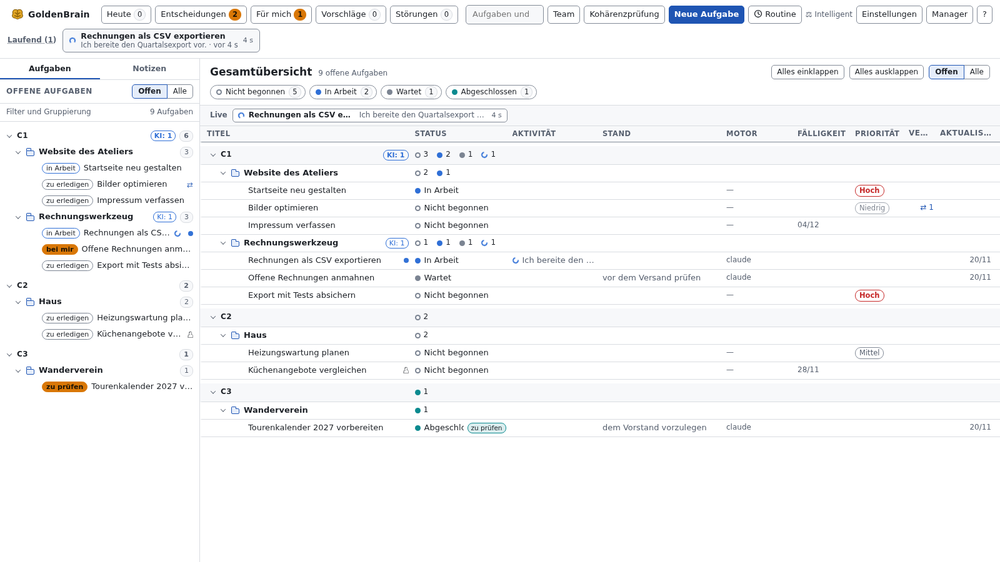
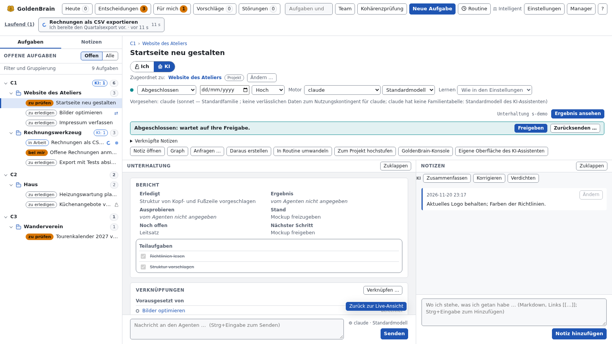
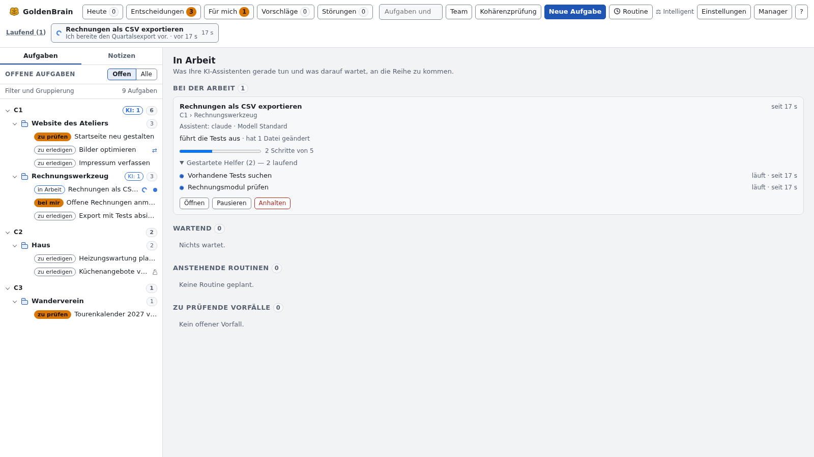
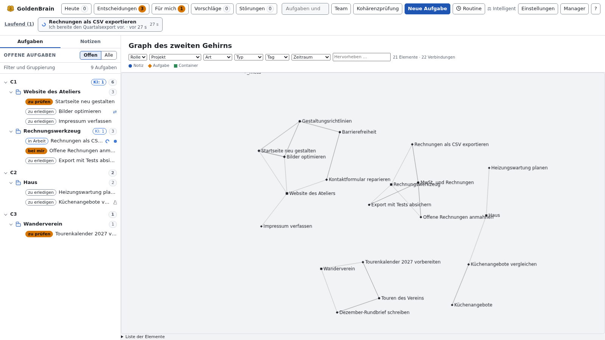

# GoldenBrain

[English](README.md) · [Français](README.fr.md) · Deutsch · [Español](README.es.md)

GoldenBrain ist ein lokaler Leitstand für Arbeit, die KI-Programmieragenten übertragen wird. Jede Aufgabe ist eine Markdown-Notiz in Ihrem Vault (ein einfacher Notizordner, mit oder ohne Obsidian), und ihre Ausführung ist eine gewöhnliche Konversation eines Kommandozeilen-Harness — Claude Code, Codex, OpenCode, GitHub Copilot CLI oder Antigravity —, die Sie jederzeit fortsetzen können. GoldenBrain ordnet ein, reiht ein, überwacht und verknüpft diese Konversationen; der Agent liefert eine kurze Ergebniskarte in die Notiz, und Sie bestätigen.









[▶ Demo-Video (etwa 40 s)](docs/captures/demo-de.webm)

Konfigurationsschlüssel und Entwurfsdokumente sind auf Französisch; dieses README, die Beitragsrichtlinie und die Sicherheitsrichtlinie gibt es in vier Sprachen. Bildschirmfotos und Video stammen aus einem fiktiven Demo-Vault (`python scripts/captures.py`).

## Schnellinstallation

**Mit einem Klick — ohne Terminal, ohne Python-Installation**

- **Windows**: `GoldenBrain-installation.exe` unter [Releases](https://github.com/Greal-dev/goldenbrain/releases) herunterladen und doppelklicken; GoldenBrain öffnet sich am Ende, danach über das Startmenü.
- **Debian, Ubuntu**: `goldenbrain_<version>_amd64.deb` herunterladen und doppelklicken (oder `sudo apt install ./goldenbrain_*.deb`); GoldenBrain steht im Anwendungsmenü.
- **macOS und andere Linux-Systeme**: ein Befehl zum Einfügen ins Terminal (Git erforderlich):
  `curl -fsSL https://github.com/Greal-dev/goldenbrain/raw/main/installation/installer.sh | bash`
  Auf dem Mac ohne Terminal: `GoldenBrain-macos-arm64.zip` (Intel: `x86_64`) in „Programme“ ziehen; erster Start per Rechtsklick → Öffnen (App nicht signiert).

Python und seine Komponenten sind enthalten; jeder Start öffnet GoldenBrain im Browser, Ein-Klick-Updates funktionieren weiter. Danach brauchen Sie einen Vault (ein leerer Ordner genügt) und einen angemeldeten KI-Assistenten (Tabelle unten). Details: [Anleitung, « Mit einem Klick »](docs/GUIDE.de.md#en-un-clic).

**Aus dem Quellcode (Entwickler)**

Voraussetzungen: Git, Python 3.12 oder neuer, ein Markdown-Vault (standardmäßig `~/Documents/Vault`; ein leerer Ordner genügt) und mindestens ein installierter **und angemeldeter** Agenten-Harness (Tabelle unten).

**Linux und macOS**

```bash
git clone https://github.com/Greal-dev/goldenbrain.git goldenbrain && cd goldenbrain
python3 -m venv .venv
.venv/bin/pip install ".[test]"
echo "$PWD/.venv/bin/python" > python.local
./lancer.sh
```

**Windows (PowerShell)**

```powershell
git clone https://github.com/Greal-dev/goldenbrain.git goldenbrain; cd goldenbrain
py -3.12 -m venv .venv
.venv\Scripts\pip install ".[test]"
Set-Content python.local "$PWD\.venv\Scripts\python.exe" -Encoding ascii
.\lancer.cmd
```

Öffnen Sie dann http://127.0.0.1:8300 (immer diese Adresse, nicht `localhost`; `lancer.cmd` öffnet sie für Sie). Der erste Start legt `config.toml` an, die nur Ihre Abweichungen enthält; alles andere kommt aus `config.exemple.toml`. Anderer Vault: in `config.toml` `[vault]`, dann `racine = "~/pfad/zum/vault"`. Anderer Port: `[serveur]`, dann `port = 8301`.

| Harness | Installation | Anmeldung |
|---|---|---|
| Claude Code | `npm install -g @anthropic-ai/claude-code` | `claude`, dann `/login` |
| Codex | `npm install -g @openai/codex` | `codex login` |
| GitHub Copilot CLI | `npm install -g @github/copilot` | `copilot login` |
| OpenCode | siehe opencode.ai | siehe seine Dokumentation |
| Antigravity (`agy`) | siehe seine Dokumentation | in der Anwendung |

Das vollständige Handbuch — erste Schritte, jeder Bildschirm, Fehlerbehebung, Start bei der Anmeldung mit systemd — ist [`docs/GUIDE.de.md`](docs/GUIDE.de.md), auch in der Anwendung (Schaltfläche « ? ») und über `python orch.py guide`.

## Wichtigste Funktionen

- **Aufgaben an Harnesses übertragen**: « Nouvelle tâche » (Neue Aufgabe), ein Titel, « Lancer tout de suite » (Sofort starten). Harness und Modell werden pro Aufgabe gewählt; Warteschlange, Prioritäten, Voraussetzungen und eine Obergrenze gleichzeitiger Agenten (fest oder nach freiem Arbeitsspeicher).
- **Bereiche Konversation und Notizen**: Die Aufgabe zeigt die Live-Konversation des Agenten neben Ihren datierten Notizen, die der Agent liest, aber nie schreibt. « Interface native du harnais » öffnet dieselbe Konversation erneut in einem Terminal.
- **Ich / KI**: Ein Schalter im Kopf der Aufgabe sagt, wer sie führt. « Moi » (Ich): kein Agent arbeitet daran; « IA » (KI): « Confier la suite » (Übergeben) gibt sie mit Ihren Notizen als Kontext zurück.
- **Zweites Gehirn und Graph**: den ganzen Vault durchsuchen, durchblättern und bearbeiten; Rückverweise, unverknüpfte Erwähnungen, lokaler und globaler Graph von Notizen, Aufgaben und Projekten. Ein Gärtner-Agent schlägt Verschiebungen und Verknüpfungen vor; nichts ändert sich ohne Ihren Klick.
- **Entscheidungen**: ein Bildschirm für alles, was auf Sie wartet — zu bestätigende Aufgaben, Fragen der Agenten, Strukturvorschläge.
- **Telegram**: Senden Sie Text, Foto oder Sprachnachricht an Ihren Bot; daraus wird eine an der richtigen Stelle abgelegte Aufgabe, und der Bot kann Ihnen Fragen stellen.
- **Telefon und andere PCs**: nur über ein privates Tailscale-Netz erreicht ein per QR-Code gekoppeltes Telefon die Oberfläche; andere PCs können Agenten für den Hauptrechner ausführen.
- **Routinen**: eine Anweisung, die ein Agent nach Zeitplan ausführt (« jeden Tag 08:00 », cron), mit Verlauf, Pause und Nachholen.
- **Automatische Aktualisierung**: Aktualisierung mit einem Klick, die `main` von [github.com/Greal-dev/goldenbrain](https://github.com/Greal-dev/goldenbrain) folgt (nur Fast-Forward, nie ein Merge), wahlweise automatisch, mit Rücksetzung bei Fehlschlag.

## GoldenBrain von einem Agenten aus steuern

Jeder Harness (Claude Code, Codex, OpenCode, Gemini CLI…) kann GoldenBrain über `python orch.py` oder die lokale REST-API steuern. Lesen Sie [`AGENTS.md`](AGENTS.md) und den Abschnitt « Pour un agent IA » des Handbuchs: Befehle, Routen, Regeln und durchgängige Beispiele.

## Bekannte Grenzen

- Ein Benutzer, ein Arbeitsplatz: Der Server lauscht auf `127.0.0.1` ohne Authentifizierung. Setzen Sie ihn nie dem Internet aus; Fernzugriff nur über Tailscale.
- Oberfläche auf Französisch, Englisch, Deutsch und Spanisch; Konfigurationsschlüssel und Entwurfsdokumente bleiben auf Französisch.
- Windows und Linux (Debian) werden täglich genutzt; macOS sollte funktionieren, wurde aber nicht erprobt.
- Ein Harness muss von Ihnen installiert und angemeldet sein; GoldenBrain installiert und bezahlt keinen. Der Copilot-CLI-Adapter wurde noch nicht mit einem echten Abonnement erprobt.
- Die Oberflächentests (Playwright) laufen nicht in der kontinuierlichen Integration; dort läuft nur `python scripts/check.py`.
- Durch GoldenBrain selbst verlassen keine Daten den Rechner; die von Ihnen gestarteten Harnesses sprechen mit ihren eigenen Anbietern.

## Für Entwickler

`CLAUDE.md` (Sitzungsvertrag), `docs/ARCHITECTURE.md` (Module, Invarianten `INV-*`), `docs/CODE_MAP.md`, [`CONTRIBUTING.de.md`](CONTRIBUTING.de.md). Prüfung: `python scripts/check.py`; Oberfläche: `python scripts/check_ui.py`.

## Lizenz

GoldenBrain ist Open-Source-Software unter der [Apache License 2.0](LICENSE); siehe auch [NOTICE](NOTICE). Beiträge sind willkommen: siehe [CONTRIBUTING.de.md](CONTRIBUTING.de.md) und die [Roadmap](ROADMAP.de.md).
