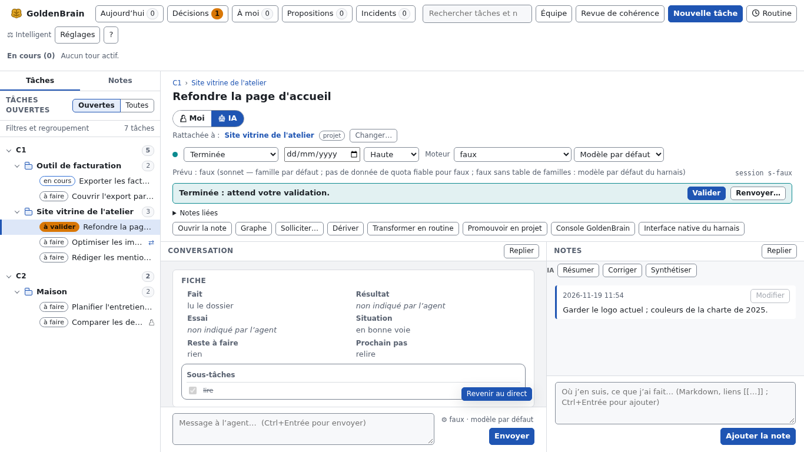

# GoldenBrain

[English](README.md) · [Français](README.fr.md) · [Deutsch](README.de.md) · Español

GoldenBrain es un puesto de mando local para el trabajo confiado a agentes de IA de programación. Cada tarea es una nota Markdown de su vault (una simple carpeta de notas, con Obsidian o sin él) y su ejecución es una conversación ordinaria de un arnés de línea de comandos — Claude Code, Codex, OpenCode, GitHub Copilot CLI o Antigravity — que puede retomar en cualquier momento. GoldenBrain coloca, pone en cola, supervisa y enlaza estas conversaciones; el agente entrega una ficha breve en la nota, y usted valida.




La interfaz, las claves de configuración y los documentos de diseño están en francés; este README, la guía de contribución y la política de seguridad existen en cuatro idiomas. Las capturas proceden de un vault de demostración ficticio (`python scripts/captures.py`).

## Instalación rápida

**En un clic — sin terminal ni Python que instalar**

- **Windows**: descargue `GoldenBrain-installation.exe` desde las [versiones](https://github.com/Greal-dev/goldenbrain/releases) y haga doble clic; GoldenBrain se abre al final y después desde el menú Inicio.
- **Debian, Ubuntu**: descargue `goldenbrain_<version>_amd64.deb` y haga doble clic (o `sudo apt install ./goldenbrain_*.deb`); GoldenBrain aparece en el menú de aplicaciones.
- **macOS y otros Linux**: un comando para pegar en un terminal (requiere Git):
  `curl -fsSL https://github.com/Greal-dev/goldenbrain/raw/main/installation/installer.sh | bash`
  En Mac sin terminal: `GoldenBrain-macos-arm64.zip` (Intel: `x86_64`), arrástrelo a Aplicaciones; primera apertura con clic derecho → Abrir (aplicación sin firmar).

Python y sus componentes van incluidos; cada inicio abre GoldenBrain en el navegador y la actualización en un clic sigue activa. Después necesita un vault (basta una carpeta vacía) y un asistente de IA conectado (tabla abajo). Detalles: [guía, « En un clic »](docs/GUIDE.md#en-un-clic).

**Desde el código (desarrolladores)**

Requisitos: Git, Python 3.12 o posterior, un vault Markdown (por defecto `~/Documents/Vault`; basta una carpeta vacía) y al menos un arnés de agente instalado **y con sesión iniciada** (tabla más abajo).

**Linux y macOS**

```bash
git clone https://github.com/Greal-dev/goldenbrain.git goldenbrain && cd goldenbrain
python3 -m venv .venv
.venv/bin/pip install ".[test]"
echo "$PWD/.venv/bin/python" > python.local
./lancer.sh
```

**Windows (PowerShell)**

```powershell
git clone https://github.com/Greal-dev/goldenbrain.git goldenbrain; cd goldenbrain
py -3.12 -m venv .venv
.venv\Scripts\pip install ".[test]"
Set-Content python.local "$PWD\.venv\Scripts\python.exe" -Encoding ascii
.\lancer.cmd
```

Abra después http://127.0.0.1:8300 (siempre esta dirección, no `localhost`; `lancer.cmd` la abre por usted). El primer arranque crea `config.toml`, que solo contiene sus diferencias; todo lo demás viene de `config.exemple.toml`. Otro vault: en `config.toml`, `[vault]` y luego `racine = "~/ruta/al/vault"`. Otro puerto: `[serveur]` y luego `port = 8301`.

| Arnés | Instalación | Inicio de sesión |
|---|---|---|
| Claude Code | `npm install -g @anthropic-ai/claude-code` | `claude`, luego `/login` |
| Codex | `npm install -g @openai/codex` | `codex login` |
| GitHub Copilot CLI | `npm install -g @github/copilot` | `copilot login` |
| OpenCode | ver opencode.ai | ver su documentación |
| Antigravity (`agy`) | ver su documentación | desde la aplicación |

La guía completa — primeros pasos, cada pantalla, resolución de problemas, arranque al iniciar sesión con systemd — es [`docs/GUIDE.md`](docs/GUIDE.md), también en la aplicación (botón « ? ») y con `python orch.py guide`.

## Funciones clave

- **Tareas confiadas a los arneses**: « Nouvelle tâche » (Nueva tarea), un título, « Lancer tout de suite » (Lanzar ya). Arnés y modelo se eligen por tarea; cola, prioridades, requisitos previos y un límite de agentes simultáneos (fijo, o según la memoria libre).
- **Paneles Conversación y Notas**: la tarea muestra la conversación en directo del agente junto a sus notas fechadas, que el agente lee pero nunca escribe. « Interface native du harnais » reabre la misma conversación en un terminal.
- **Yo / IA**: un interruptor en la cabecera de la tarea indica quién la lleva. « Moi » (Yo): ningún agente trabaja en ella; « IA »: « Confier la suite » (Ceder) se la devuelve al agente, con sus notas como contexto.
- **Segundo cerebro y grafo**: recorrer, buscar y editar todo el vault; retroenlaces, menciones no enlazadas, grafo local y global de notas, tareas y proyectos. Un agente jardinero propone movimientos y enlaces; nada cambia sin su clic.
- **Decisiones**: una pantalla para todo lo que le espera — tareas por validar, preguntas de los agentes, propuestas de estructura.
- **Telegram**: envíe un texto, una foto o una nota de voz a su bot; se convierte en una tarea archivada en el lugar adecuado, y el bot puede hacerle preguntas.
- **Teléfono y otros PC**: solo a través de una red privada Tailscale, un teléfono emparejado por código QR accede a la interfaz; otros PC pueden ejecutar agentes para el puesto principal.
- **Rutinas**: una instrucción que un agente ejecuta según un horario (« cada día 08:00 », cron), con historial, pausa y recuperación.
- **Actualización automática**: actualización en un clic que sigue `main` de [github.com/Greal-dev/goldenbrain](https://github.com/Greal-dev/goldenbrain) (solo avance rápido, nunca una fusión), automática si se desea, con vuelta atrás en caso de fallo.

## Pilotar GoldenBrain desde un agente

Cualquier arnés (Claude Code, Codex, OpenCode, Gemini CLI…) puede pilotar GoldenBrain mediante `python orch.py` o la API REST local. Lea [`AGENTS.md`](AGENTS.md) y la sección « Pour un agent IA » de la guía: comandos, rutas, reglas y ejemplos de principio a fin.

## Limitaciones conocidas

- Un solo usuario, un solo puesto: el servidor escucha en `127.0.0.1` sin autenticación. No lo exponga nunca a Internet; el acceso remoto pasa solo por Tailscale.
- Interfaz solo en francés (la traducción figura en la [hoja de ruta](ROADMAP.es.md)).
- Windows y Linux (Debian) se usan a diario; macOS debería funcionar pero no se ha probado.
- Usted debe instalar el arnés e iniciar su sesión; GoldenBrain no instala ni paga ninguno. El adaptador de Copilot CLI aún no se ha probado con una suscripción real.
- Las pruebas de interfaz (Playwright) no se ejecutan en integración continua; allí solo se ejecuta `python scripts/check.py`.
- Ningún dato sale de la máquina por obra de GoldenBrain mismo; los arneses que usted lanza hablan con sus propios proveedores.

## Para desarrolladores

`CLAUDE.md` (contrato de sesión), `docs/ARCHITECTURE.md` (módulos, invariantes `INV-*`), `docs/CODE_MAP.md`, [`CONTRIBUTING.es.md`](CONTRIBUTING.es.md). Puerta: `python scripts/check.py`; interfaz: `python scripts/check_ui.py`.

## Licencia

GoldenBrain es software de código abierto bajo la [Licencia Apache 2.0](LICENSE); véase también [NOTICE](NOTICE). Las contribuciones son bienvenidas: véanse [CONTRIBUTING.es.md](CONTRIBUTING.es.md) y la [hoja de ruta](ROADMAP.es.md).
