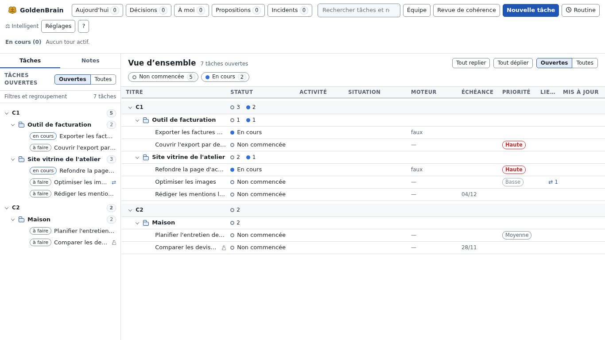
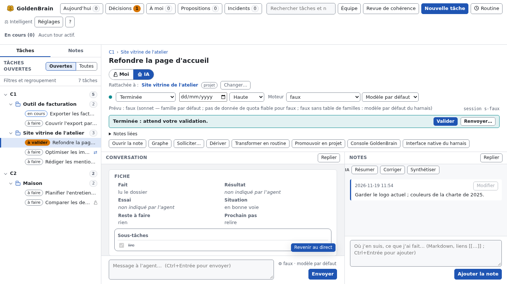

# GoldenBrain

[English](README.md) · Français · [Deutsch](README.de.md) · [Español](README.es.md)

GoldenBrain est un poste de pilotage local pour le travail confié à des agents IA de programmation. Chaque tâche est une note Markdown de votre vault (un simple dossier de notes, Obsidian ou non) et son exécution est une conversation ordinaire d'un harnais en ligne de commande — Claude Code, Codex, OpenCode, GitHub Copilot CLI ou Antigravity — que vous pouvez reprendre à tout moment. GoldenBrain place, met en file, surveille et relie ces conversations ; l'agent rend une fiche courte dans la note, et vous validez.





L'interface, les clés de configuration et les documents de conception sont en français ; ce README, le guide de contribution et la politique de sécurité existent en quatre langues. Les captures proviennent d'un vault de démonstration fictif (`python scripts/captures.py`).

## Installation rapide

**En un clic — sans terminal ni Python à installer**

- **Windows** : téléchargez `GoldenBrain-installation.exe` depuis les [versions](https://github.com/Greal-dev/goldenbrain/releases), double-cliquez ; GoldenBrain s'ouvre à la fin, puis depuis le menu Démarrer.
- **Debian, Ubuntu** : téléchargez `goldenbrain_<version>_amd64.deb`, double-cliquez (ou `sudo apt install ./goldenbrain_*.deb`) ; GoldenBrain est dans le menu des applications.
- **macOS et autres Linux** : une commande à copier-coller dans un terminal (Git requis) :
  `curl -fsSL https://github.com/Greal-dev/goldenbrain/raw/main/installation/installer.sh | bash`
  Sur Mac, sans terminal : `GoldenBrain-macos-arm64.zip` (Intel : `x86_64`), à glisser dans Applications ; première ouverture par clic droit → Ouvrir (application non signée).

Python et ses composants sont embarqués ; chaque lancement ouvre GoldenBrain dans le navigateur, et la mise à jour d'un clic reste active. Il vous faut ensuite un vault (un dossier vide suffit) et un assistant IA connecté (tableau ci-dessous). Détails : [guide, « En un clic »](docs/GUIDE.md#en-un-clic).

**Depuis le code (développeurs)**

Prérequis : Git, Python 3.12 ou plus récent, un vault Markdown (par défaut `~/Documents/Vault` ; un dossier vide suffit), et au moins un harnais d'agent installé **et connecté** (tableau ci-dessous).

**Linux et macOS**

```bash
git clone https://github.com/Greal-dev/goldenbrain.git goldenbrain && cd goldenbrain
python3 -m venv .venv
.venv/bin/pip install ".[test]"
echo "$PWD/.venv/bin/python" > python.local
./lancer.sh
```

**Windows (PowerShell)**

```powershell
git clone https://github.com/Greal-dev/goldenbrain.git goldenbrain; cd goldenbrain
py -3.12 -m venv .venv
.venv\Scripts\pip install ".[test]"
Set-Content python.local "$PWD\.venv\Scripts\python.exe" -Encoding ascii
.\lancer.cmd
```

Ouvrez ensuite http://127.0.0.1:8300 (toujours cette adresse, pas `localhost` ; `lancer.cmd` l'ouvre pour vous). Le premier lancement crée `config.toml`, qui ne contient que vos écarts ; tout le reste vient de `config.exemple.toml`. Autre vault : dans `config.toml`, `[vault]` puis `racine = "~/chemin/du/vault"`. Autre port : `[serveur]` puis `port = 8301`.

| Harnais | Installation | Connexion |
|---|---|---|
| Claude Code | `npm install -g @anthropic-ai/claude-code` | `claude`, puis `/login` |
| Codex | `npm install -g @openai/codex` | `codex login` |
| GitHub Copilot CLI | `npm install -g @github/copilot` | `copilot login` |
| OpenCode | voir opencode.ai | voir sa documentation |
| Antigravity (`agy`) | voir sa documentation | depuis l'application |

Le guide complet — premiers pas, chaque écran, dépannage, démarrage à l'ouverture de session avec systemd — est [`docs/GUIDE.md`](docs/GUIDE.md), aussi dans l'application (bouton « ? ») et par `python orch.py guide`.

## Fonctions clés

- **Tâches confiées aux harnais** : « Nouvelle tâche », un titre, « Lancer tout de suite ». Harnais et modèle se choisissent par tâche ; file, priorités, prérequis et plafond d'agents simultanés (fixe, ou selon la mémoire libre).
- **Volets Conversation et Notes** : la tâche montre la conversation en direct de l'agent à côté de vos notes datées, que l'agent lit mais n'écrit jamais. « Interface native du harnais » rouvre la même conversation dans un terminal.
- **Moi / IA** : un interrupteur dans l'en-tête de la tâche dit qui la mène. « Moi » : aucun agent n'y travaille ; « IA » : « Confier la suite » la rend à l'agent, avec vos notes pour contexte.
- **Second cerveau et graphe** : parcourir, chercher et modifier tout le vault ; rétroliens, mentions non liées, graphe local et global des notes, tâches et projets. Un agent jardinier propose déplacements et liens ; rien ne change sans votre clic.
- **Décisions** : un écran pour tout ce qui vous attend — tâches à valider, questions des agents, propositions de structure.
- **Telegram** : envoyez un texte, une photo ou une note vocale à votre bot ; il devient une tâche rangée au bon endroit, et le bot peut vous poser des questions.
- **Téléphone et autres PC** : par un réseau privé Tailscale seulement, un téléphone appairé par QR code atteint l'interface ; d'autres PC peuvent exécuter des agents pour le poste principal.
- **Routines** : une consigne exécutée par un agent selon un horaire (« chaque jour 08:00 », cron), avec historique, pause et rattrapage.
- **Mise à jour automatique** : mise à jour en un clic qui suit `main` de [github.com/Greal-dev/goldenbrain](https://github.com/Greal-dev/goldenbrain) (avance rapide seulement, jamais de fusion), automatique au choix, avec retour arrière en cas d'échec.

## Piloter GoldenBrain depuis un agent

Tout harnais (Claude Code, Codex, OpenCode, Gemini CLI…) peut piloter GoldenBrain par `python orch.py` ou par l'API REST locale. Lisez [`AGENTS.md`](AGENTS.md) et la section « Pour un agent IA » du guide : commandes, routes, règles et exemples de bout en bout.

## Limites connues

- Un seul utilisateur, un seul poste : le serveur écoute sur `127.0.0.1` sans authentification. Ne l'exposez jamais à Internet ; l'accès à distance passe par Tailscale seulement.
- Interface en français seulement (la traduction est à la [feuille de route](ROADMAP.fr.md)).
- Windows et Linux (Debian) servent au quotidien ; macOS devrait fonctionner mais n'a pas été essayé.
- Un harnais doit être installé et connecté par vous ; GoldenBrain n'en installe ni n'en paie aucun. L'adaptateur Copilot CLI n'a pas encore été essayé sur un abonnement réel.
- Les tests d'interface (Playwright) ne tournent pas en intégration continue ; seul `python scripts/check.py` y tourne.
- Aucune donnée ne quitte la machine du fait de GoldenBrain lui-même ; les harnais que vous lancez parlent à leurs propres fournisseurs.

## Pour les développeurs

`CLAUDE.md` (contrat de session), `docs/ARCHITECTURE.md` (modules, invariants `INV-*`), `docs/CODE_MAP.md`, [`CONTRIBUTING.fr.md`](CONTRIBUTING.fr.md). Porte : `python scripts/check.py` ; interface : `python scripts/check_ui.py`.

## Licence

GoldenBrain est un logiciel libre, sous [licence Apache 2.0](LICENSE) ; voir aussi [NOTICE](NOTICE). Les contributions sont bienvenues : voir [CONTRIBUTING.fr.md](CONTRIBUTING.fr.md) et la [feuille de route](ROADMAP.fr.md).
